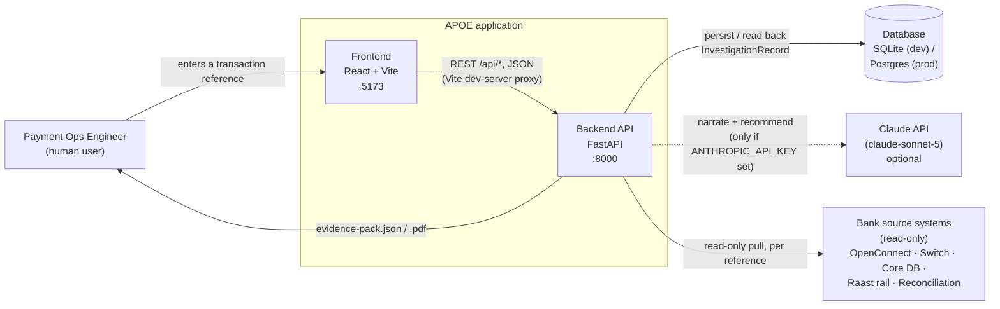
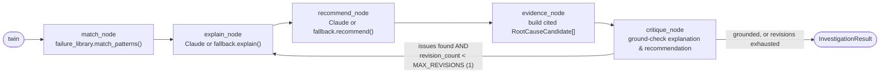
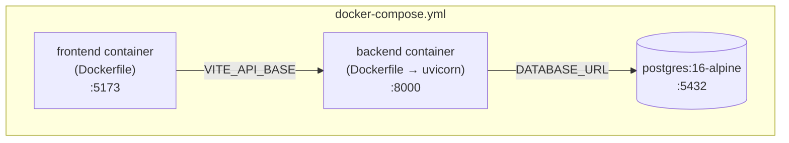
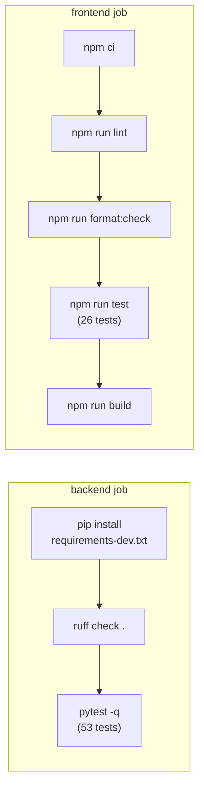

# System Architecture

This document is the concrete, as-built companion to [`ARCHITECTURE.md`](./ARCHITECTURE.md)
(which describes the four conceptual layers and *why* they're split that way).
Here, the goal is different: show exactly how the real repository — every
file, module, and request — implements those layers, with diagrams.

> **AI Payment Operations Engineer (APOE)** is a Raast P2P payment
> investigation tool. Given a transaction reference, it deterministically
> reconstructs what happened across five source systems, detects where (if
> anywhere) the flow broke, and uses an AI reasoning layer to narrate the
> break in plain language and draft a recommended next action — never to
> execute one.

---

## 1. System context

Who/what talks to this system, and what it talks to.



- **In production**, `sources` would be real read-only credentials into each
  bank system. **In this MVP/demo build**, all five connectors read from
  static JSON fixtures under `backend/app/connectors/fixtures/` — see
  [§5](#5-connectors--layer-1) — so the whole system runs with zero external
  dependencies.
- The Claude API call is the **only** component permitted to leave the
  deployment perimeter, and only when `ANTHROPIC_API_KEY` is configured. With
  no key, a deterministic template-based fallback produces the same shaped
  output — the app is fully functional offline (see [§7](#7-reasoning-agent--layer-3)).

---

## 2. Repository layout

```
AI-PaymentOperationsEngineer/
├── backend/                          FastAPI application (Python 3.11)
│   ├── app/
│   │   ├── main.py                   FastAPI app, CORS, lifespan (init_db)
│   │   ├── core/
│   │   │   └── config.py             Typed Settings (pydantic-settings)
│   │   ├── db.py                     SQLAlchemy engine/session/Base
│   │   ├── api/
│   │   │   ├── routes.py             All HTTP endpoints
│   │   │   └── demo_data.py          Seeded demo reference list
│   │   ├── connectors/                Layer 1 — read-only source adapters
│   │   │   ├── base.py               Connector protocol, TimeWindow, ConnectorHealth
│   │   │   ├── fixture_connectors.py Five fixture-backed connectors
│   │   │   ├── registry.py           CONNECTORS = [...] (the five, instantiated)
│   │   │   └── fixtures/*.json       Static demo data per source system
│   │   ├── correlation/               Layer 2 — deterministic engine
│   │   │   ├── engine.py             correlate() — builds the Twin
│   │   │   ├── rules.py              Stage → expected-artifact rules
│   │   │   └── failure_library.py    match_patterns() against failure-library/
│   │   ├── agent/                     Layer 3 — reasoning
│   │   │   ├── graph.py              LangGraph state machine (investigate())
│   │   │   ├── claude_reasoning.py   Real Claude API calls
│   │   │   └── fallback.py           Deterministic template reasoning (no LLM)
│   │   ├── evidence/                  Layer 4 — export
│   │   │   ├── json_export.py
│   │   │   └── pdf_export.py         ReportLab PDF generation
│   │   └── models/
│   │       ├── schemas.py            Pydantic models (Twin, Hop, RootCause, ...)
│   │       └── orm.py                SQLAlchemy InvestigationRecord table
│   ├── failure-library/raast-p2p/*.yaml   Known break-pattern definitions
│   ├── tests/                        53 pytest tests (see docs/TEST_CASES.md)
│   ├── pyproject.toml                ruff config
│   ├── requirements.txt              Production dependencies
│   ├── requirements-dev.txt          + pytest, httpx, ruff
│   └── Dockerfile
│
├── frontend/                         React + TypeScript (Vite)
│   └── src/
│       ├── main.tsx                  React root
│       ├── App.tsx                   Top-level orchestration / page state
│       ├── api/client.ts             Typed fetch wrapper around /api/*
│       ├── types.ts                  TypeScript mirror of the backend schemas
│       ├── hooks/useTheme.ts         Light/dark/system theme persistence
│       ├── components/
│       │   ├── ReferenceSearch.tsx   Reference input + demo-fixture chips
│       │   ├── Timeline.tsx          Renders ordered Hops
│       │   ├── HopCard.tsx           One hop: status, artifacts, expand/collapse
│       │   ├── ExplanationPanel.tsx  Agent's plain-language narration
│       │   ├── RootCausePanel.tsx    Ranked root-cause candidates + citations
│       │   ├── RecommendationPanel.tsx  Drafted action + evidence-pack downloads
│       │   ├── ConnectorStatusBar.tsx   Live health pill per connector
│       │   └── ThemeToggle.tsx
│       └── **/*.test.{ts,tsx}        26 Vitest + Testing Library tests
│
├── docs/                             Design docs (this file + 7 others)
├── docker-compose.yml                Postgres + backend + frontend, for prod-like local runs
└── .github/workflows/ci.yml          Lint + test + build, both stacks
```

---

## 3. Request lifecycle: "investigate a transaction"

This is the single most important flow in the system — everything else
supports it. Sequence for `POST /api/investigations`:

```mermaid
sequenceDiagram
    actor User
    participant FE as Frontend (App.tsx)
    participant API as FastAPI (routes.py)
    participant CONN as 5 Connectors
    participant CORR as Correlation Engine
    participant AGENT as LangGraph Agent
    participant FLIB as Failure Library
    participant CLAUDE as Claude API (optional)
    participant DB as SQLite / Postgres

    User->>FE: enters reference, clicks Investigate
    FE->>API: POST /api/investigations {reference, reference_type}
    API->>CORR: correlate(ref, CONNECTORS)
    CORR->>CONN: fetch(ref) — each connector, in parallel logically
    CONN-->>CORR: RawArtifact[] per source
    CORR->>CORR: assemble into 8 ordered Hops,<br/>detect first break (rule-based)
    CORR-->>API: TransactionDigitalTwin

    API->>AGENT: investigate(twin)
    AGENT->>FLIB: match_patterns(twin)
    FLIB-->>AGENT: ranked (pattern, confidence) pairs
    alt ANTHROPIC_API_KEY set
        AGENT->>CLAUDE: explain(twin), recommend(twin, matches)
        CLAUDE-->>AGENT: narration + recommendation text
    else no API key
        AGENT->>AGENT: fallback.explain() / fallback.recommend()<br/>(deterministic templates)
    end
    AGENT->>AGENT: evidence_node — builds cited RootCauseCandidate[]
    AGENT->>AGENT: critique_node — checks explanation/recommendation<br/>are grounded in the same facts; revises once if not
    AGENT-->>API: InvestigationResult (schema-validated)

    API->>DB: INSERT/UPDATE investigations (id, reference, result_json)
    API-->>FE: 201 Created, InvestigationResult
    FE->>FE: render Timeline, ExplanationPanel,<br/>RootCausePanel, RecommendationPanel
```

**Why this shape matters:** the correlation engine (deterministic) runs
*before* and *independently of* the agent. The agent only ever reads the
`TransactionDigitalTwin` that correlation already produced — it cannot
invent a hop, alter a status, or fabricate an artifact. Every root-cause
citation is validated at the Pydantic layer (`InvestigationResult` model
validator) to reference a real `Hop.id` in that same twin, so an ungrounded
claim cannot survive construction of the response, regardless of what the
model (or the fallback) produced.

---

## 4. Backend module dependency graph

```mermaid
flowchart TD
    main["main.py<br/>(FastAPI app, CORS, lifespan)"]
    routes["api/routes.py"]
    demo["api/demo_data.py"]
    core["core/config.py<br/>(Settings)"]
    db["db.py<br/>(engine, SessionLocal, Base)"]
    orm["models/orm.py<br/>(InvestigationRecord)"]
    schemas["models/schemas.py<br/>(Twin, Hop, RootCause, ...)"]

    registry["connectors/registry.py<br/>(CONNECTORS)"]
    fixtureconn["connectors/fixture_connectors.py"]
    base["connectors/base.py<br/>(Connector protocol)"]

    engine["correlation/engine.py<br/>(correlate)"]
    rules["correlation/rules.py"]
    flib["correlation/failure_library.py"]

    graph["agent/graph.py<br/>(investigate, LangGraph)"]
    claude["agent/claude_reasoning.py"]
    fallback["agent/fallback.py"]

    jsonexp["evidence/json_export.py"]
    pdfexp["evidence/pdf_export.py"]

    main --> routes
    main --> core
    main --> db
    routes --> engine
    routes --> graph
    routes --> registry
    routes --> jsonexp
    routes --> pdfexp
    routes --> orm
    routes --> demo
    routes --> schemas

    db --> core
    orm --> db

    registry --> fixtureconn
    fixtureconn --> base
    base --> schemas

    engine --> rules
    engine --> base
    engine --> schemas

    graph --> claude
    graph --> fallback
    graph --> flib
    graph --> schemas
    claude --> schemas
    fallback --> schemas

    jsonexp --> schemas
    pdfexp --> schemas
```

Key invariant enforced by this graph: **nothing in `correlation/` or
`connectors/` imports from `agent/`.** The dependency arrow only ever points
from "reasoning" back to "facts," never the other way — that's the
deterministic/AI split made structural, not just documented.

---

## 5. Connectors — Layer 1

Five modules, one per source system, each implementing the same protocol
(`backend/app/connectors/base.py`):

```python
class Connector(Protocol):
    name: str
    def fetch(self, ref: TransactionRef, window: TimeWindow | None = None) -> list[RawArtifact]: ...
    def healthcheck(self) -> ConnectorHealth: ...
```

| Connector | `name` | Fixture file | Represents |
|---|---|---|---|
| `OpenConnectLogsConnector` | `openconnect-logs` | `openconnect_logs.json` | Channel + auth + API-call logs |
| `SwitchLogsConnector` | `payment-switch-logs` | `switch_logs.json` | Payment switch decision logs |
| `TransactionDBConnector` | `transaction-db` | `transaction_db.json` | Core transaction/ledger DB rows |
| `RaastResponseConnector` | `raast-response` | `raast_response.json` | Rail response codes + beneficiary ack |
| `ReconciliationConnector` | `reconciliation-file` | `reconciliation.json` | EOD settlement reconciliation entries |

There is **no write method anywhere in this package** — enforced both by the
`Protocol` definition and by a dedicated test
(`test_connectors.py::test_fetch_is_read_only_interface`). In this MVP build,
`FixtureConnector.fetch()` matches a `TransactionRef` against fixture records
by `core_transaction_id` / `rail_reference` / `session_id`. Swapping a
fixture for a live source means implementing the same two-method contract
against a real read-only credential — no caller-side changes anywhere in
correlation, the agent, or the API layer.

---

## 6. Correlation engine — Layer 2 (deterministic, no LLM)

`correlate(ref, CONNECTORS)` in `correlation/engine.py`:

1. Calls `fetch()` on all five connectors for the given reference.
2. For each of the 8 canonical `HopStage`s (in fixed order — see
   `HOP_STAGE_ORDER` in `models/schemas.py`), looks up which connector +
   `artifact_type` (+ optional payload filter) is expected, per
   `correlation/rules.py::STAGE_ARTIFACT_RULES`.
3. Sorts matching artifacts by timestamp and evaluates the stage:
   - **No artifacts found** → `status="break"`, "expected artifact not found."
   - **An artifact reports a non-success outcome** (`extract_outcome()`
     reads `status`/`outcome`/`result` against a known-success set) →
     `status="break"`, reason quoted from the payload.
   - **Otherwise** → `status="ok"`.
   - Once a break occurs, every later stage is marked `"unknown"`
     ("not reached") rather than evaluated — a flow doesn't have two
     independent breaks in this model, it has one root break with
     downstream consequences.
4. Returns a `TransactionDigitalTwin`: the 8 ordered `Hop`s, the id of the
   first break (if any), and a `correlation_version` string for audit.

The 8 hop stages, in order:

```
customer_channel → authentication → payment_api → payment_switch →
payment_rail → receiving_institution → core_banking → settlement_reconciliation
```

**Failure-library matching** (`correlation/failure_library.py`) is a
*second*, still fully deterministic step: given the twin's break hop, it
loads YAML pattern definitions from `backend/failure-library/raast-p2p/*.yaml`
and scores each candidate pattern (0.0–1.0) by comparing the break's stage
and signature (`missing_artifact` vs `contradictory_status` + a substring
match on the hop's notes) against the pattern's declared signature. No model
call is involved in this ranking — only in narrating the result afterward.

---

## 7. Reasoning agent — Layer 3

`agent/graph.py` builds a small [LangGraph](https://langchain-ai.github.io/langgraph/)
state machine, `investigate(twin) -> InvestigationResult`:



- **`match_node`** ranks failure-library patterns against the twin's break
  (deterministic, described above).
- **`explain_node` / `recommend_node`** call `agent/claude_reasoning.py` if
  `ANTHROPIC_API_KEY` is set, else `agent/fallback.py`. Both paths produce
  the same shape of output; only prose quality differs. The Claude prompts
  explicitly instruct the model to state only facts present in the twin
  summary and to never claim an action has been taken.
- **`evidence_node`** is the layer where citation enforcement actually
  happens: it builds `RootCauseCandidate`s from the failure-library matches,
  each one citing the specific `Hop.id` that broke. This step **never**
  calls the model — root causes are structurally deterministic.
- **`critique_node`** is a bounded self-correction loop: it checks whether
  the free-text `explanation` names the actual break stage, and whether
  `recommendation` references the actual top-matched pattern — both checked
  against the *same facts* `evidence_node` used, never against "model
  opinion." If not grounded, it routes back to `explain_node` with specific
  feedback, capped at `MAX_REVISIONS = 1` so the loop always terminates.
  `InvestigationResult.self_corrected` records whether a revision fired.
- The agent has **no tool binding capable of a write operation** — it can
  only read the twin and the failure library and emit text/structured
  output, enforced at the graph level, not just by prompt instruction.

`model_version` on the result is either
`apoe-fallback-reasoning-2026.08.1` or
`claude-sonnet-5+apoe-agent-2026.08.1`, so every stored investigation
records which reasoning path produced it.

---

## 8. Schema-level guardrails

`models/schemas.py` is the data contract every layer reads and writes
through — and it's also where the citation-integrity guarantee is actually
enforced, via Pydantic `model_validator`s, not convention:

| Model | Validator | Guards against |
|---|---|---|
| `Hop` | `_ok_requires_artifacts` | A hop marked "ok" with zero supporting evidence |
| `TransactionDigitalTwin` | `_break_hop_must_exist` | A `break_hop_id` pointing at a hop that isn't in this twin |
| `RootCauseCandidate` | `_non_empty_citation` | A root cause with no cited evidence at all |
| `InvestigationResult` | `_citations_resolve_to_real_hops` | **The core guarantee**: every `cited_hop_id` in every root cause must resolve to a real `Hop.id` in this exact twin — an uncited or fabricated claim cannot survive construction of the response object |

This is why the reasoning agent "cannot lie" in a way that reaches the API
response: even if a future prompt change or a different model produced a
hallucinated citation, object construction itself raises `ValidationError`
before it ever reaches the client.

---

## 9. Evidence pack — Layer 4

Pure serialization, no new content generated at export time — both exports
just format the already-validated `InvestigationResult`:

- `evidence/json_export.py` → `result.model_dump_json()`, downloadable as
  `evidence-pack-{id}.json`.
- `evidence/pdf_export.py` → a ReportLab-built PDF (incident header, hop
  timeline table, root-cause list, recommendation, per-hop evidence
  artifacts) structured to map onto standard incident-record / root-cause /
  timeline / audit-trail categories, downloadable as
  `evidence-pack-{id}.pdf`.

---

## 10. API surface

All routes live in `backend/app/api/routes.py`, mounted under `/api` (plus a
top-level `/health`):

| Method | Path | Purpose |
|---|---|---|
| `GET` | `/health` | Liveness check |
| `POST` | `/api/investigations` | Run a full investigation for `{reference, reference_type}`; persists and returns the result (201) |
| `GET` | `/api/investigations` | Last 20 investigations, newest first |
| `GET` | `/api/investigations/{id}` | Re-fetch a stored investigation (404 if unknown) |
| `GET` | `/api/investigations/{id}/evidence-pack.json` | Download JSON evidence pack |
| `GET` | `/api/investigations/{id}/evidence-pack.pdf` | Download PDF evidence pack |
| `GET` | `/api/connectors/status` | Health of all five connectors |
| `GET` | `/api/demo/references` | The five seeded demo fixture references, for the UI's quick-start chips |

Every route is covered by `backend/tests/test_api.py` — see
[`docs/TEST_CASES.md`](./TEST_CASES.md).

---

## 11. Persistence

`backend/app/db.py` configures a single SQLAlchemy engine/session, pointed
at `DATABASE_URL` (via `app/core/config.py`'s typed `Settings`) — SQLite by
default (`sqlite:///./apoe.db`), Postgres in the Docker Compose stack. The
only table, `investigations` (`models/orm.py`), stores the **entire**
`InvestigationResult` as a JSON blob keyed by the twin's own UUID:

```
investigations
├── id            String, primary key   (== twin.id)
├── reference     String, indexed
├── created_at    DateTime
└── result_json   JSON                  (the full InvestigationResult)
```

`GET /api/investigations/{id}` re-validates that JSON blob back through the
`InvestigationResult` Pydantic model on the way out — so the guardrails in
[§8](#8-schema-level-guardrails) apply on read as well as on write.

---

## 12. Frontend

React 18 + TypeScript, built with Vite. Single-page, no router (one
investigation view).

```mermaid
flowchart TD
    App["App.tsx<br/>owns: demoReferences, connectorStatuses,<br/>result, loading, error"]
    App --> RS["ReferenceSearch<br/>input + demo-fixture chips"]
    App --> CSB["ConnectorStatusBar<br/>health pills"]
    App --> TT["ThemeToggle"]
    App --> TL["Timeline"]
    App --> EP["ExplanationPanel"]
    App --> RCP["RootCausePanel"]
    App --> RP["RecommendationPanel"]
    TL --> HC["HopCard<br/>× 8, expand/collapse, artifact JSON"]

    App -.->|useTheme()| UT["hooks/useTheme.ts<br/>localStorage + data-theme attr"]
    App -.->|createInvestigation()<br/>getConnectorStatus()<br/>getDemoReferences()| Client["api/client.ts<br/>typed fetch wrapper"]
    RP -.->|evidencePackUrl()| Client
```

- **`api/client.ts`** is the only module that calls `fetch()` — every
  request goes to a relative `/api/...` path; in dev, Vite's proxy
  (`vite.config.ts`) forwards those to `http://127.0.0.1:8000`, so no CORS
  configuration is needed beyond what's already declared in `app/main.py`.
- **`types.ts`** is a hand-maintained TypeScript mirror of the backend
  Pydantic schemas — there's no codegen step; a schema change on the backend
  needs a matching edit here.
- **`RootCausePanel`**'s "view cited evidence →" links scroll to the DOM
  node for the cited hop (`id="hop-{hopId}"`, rendered by `HopCard`) — the
  citation guarantee from [§8](#8-schema-level-guardrails) is visible in the UI, not
  just enforced server-side.
- **`RecommendationPanel`** always renders the disclaimer "Drafted for human
  review only — never auto-executed" alongside the two evidence-pack
  download links — the UI-level reinforcement of the no-write-action
  guarantee.

---

## 13. Deployment



Two supported local paths (see [`docs/SETUP.md`](./SETUP.md)):

1. **Zero-Docker dev loop** — `uvicorn` + SQLite for the backend, `npm run
   dev` for the frontend. Fastest inner loop; what CI and the test suite use.
2. **`docker compose up --build`** — Postgres-backed, closer to the intended
   deployment shape (on-prem / bank tenancy, per `docs/ARCHITECTURE.md`
   §Deployment). No component requires public-internet egress except the
   optional Claude API call.

`backend/Dockerfile` installs only `requirements.txt` (production
dependencies) — `requirements-dev.txt` (pytest, ruff, httpx) never ships in
the image.

---

## 14. CI/CD

`.github/workflows/ci.yml` runs two independent jobs on every push/PR:



Both jobs must pass before a PR is mergeable in spirit (no branch-protection
rule is asserted here — that's a repo-settings decision, not a code one).

---

## 15. Design principles this architecture encodes

1. **Deterministic before generative.** Everything a human could be held
   accountable for (what happened, where it broke, what evidence supports
   that) is computed by rule-based code with no model call. The model only
   narrates and ranks against work already done.
2. **Citations are structural, not aspirational.** The guarantee that "every
   claim traces to real evidence" is enforced by Pydantic validators that
   run on every construction of `InvestigationResult` — including on read
   from the database — not by a prompt instruction alone.
3. **No write path, anywhere, by construction.** The `Connector` protocol
   has no write method. The agent has no tool binding for one. The UI's
   copy says so explicitly. This is enforced at three independent layers on
   purpose.
4. **The AI is a swappable, optional layer.** With no API key, the app is
   fully functional via `agent/fallback.py`. The one component allowed to
   leave the deployment perimeter (`claude_reasoning.py`) is isolated behind
   a narrow two-function interface specifically so a design partner
   requiring air-gapping can substitute a self-hosted model without an
   architecture change.
5. **Tests mirror the architecture.** Each layer above has its own test
   file (`test_connectors.py`, `test_correlation.py`, `test_agent.py`,
   `test_schemas.py`, `test_evidence.py`, `test_api.py`) — see
   [`docs/TEST_CASES.md`](./TEST_CASES.md) for the full inventory.

## Related docs

- [`ARCHITECTURE.md`](./ARCHITECTURE.md) — the original four-layer design rationale
- [`DATA_MODEL.md`](./DATA_MODEL.md) — full field-level schema reference
- [`GUARDRAILS.md`](./GUARDRAILS.md) — the safety/compliance constraints this design satisfies
- [`API.md`](./API.md) — request/response examples per endpoint
- [`SETUP.md`](./SETUP.md) — how to run this locally
- [`TEST_CASES.md`](./TEST_CASES.md) — the full automated test inventory
